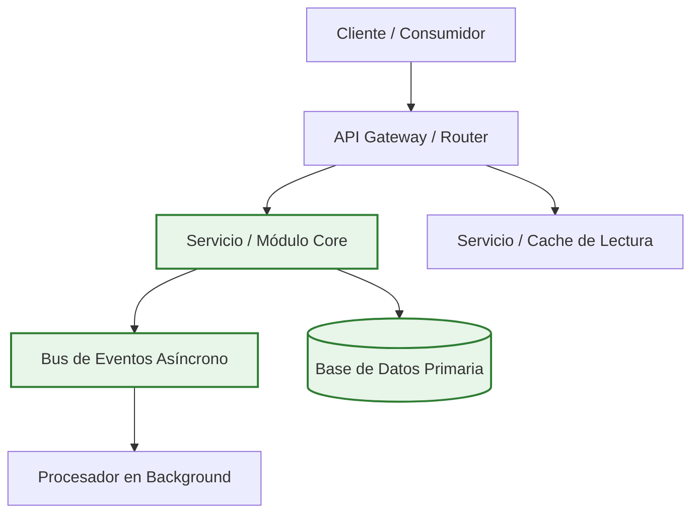

# Plantilla de Informe: Registro de Decisión Arquitectónica (ADR / System Design)

Usa esta plantilla cuando la necesidad del usuario sea definir una arquitectura técnica completa, diseñar un subsistema, elegir entre paradigmas (ej. Event-Driven vs Monolito modular) o seleccionar infraestructura crítica.

```markdown
# 🏛️ Registro de Decisión Arquitectónica (ADR): `{{DECISION_TITLE}}`

> **Estado:** Aprobado / Propuesto
> **Contexto:** {{BUSINESS_OR_TECH_CONTEXT}}
> **Decisión Tomada:** Se adopta **{{CHOSEN_OPTION}}** como arquitectura estándar.

---

## 🗺️ Diagrama de Arquitectura de la Solución



---

## ⚖️ Comparativa de Enfoques Evaluados

| Opción Arquitectónica | Ventajas Clave | Desventajas / Deuda | Costo Operativo | Veredicto |
| :-------------------- | :------------- | :------------------ | :-------------: | :-------- |
| **Opción 1: {{OPT1_NAME}}** | {{OPT1_PROS}} | {{OPT1_CONS}} | 💲 Bajo | Descartado (No escala) |
| **Opción 2: {{CHOSEN_OPTION}}** | {{OPT2_PROS}} | {{OPT2_CONS}} | 💲💲 Moderado | 🏆 **Seleccionado** |
| **Opción 3: {{OPT3_NAME}}** | {{OPT3_PROS}} | {{OPT3_CONS}} | 💲💲💲 Elevado | Descartado (Sobrediseño) |

---

## 📐 Justificación Técnica y Consecuencias

### Por qué se eligió esta opción:
1. **Escalabilidad horizontal comprobada:** Permite aislar fallos sin comprometer la disponibilidad del sistema completo.
2. **Bajo acoplamiento:** Los módulos se comunican mediante contratos de interfaz explícitos.
3. **Mantenibilidad:** El código resultante es modular y desacoplado de proveedores propietarios.

### Consecuencias Positivas:
- Reducción del tiempo de despliegue en un X%.
- Facilidad de testeo unitario e integración sin mocks complejos.

### Consecuencias Negativas y Mitigación:
- **Sobrecarga inicial:** Requiere definir esquemas de eventos estrictos.  
  *Mitigación:* Se implementa validación con esquemas JSON/Zod en tiempo de compilación.

---

## 📦 Blueprint de Implementación Inicial (Scaffolding / Configuración)

```{{LANG}}
{{ARCHITECTURE_SCAFFOLDING_OR_CONFIG_CODE}}
```
```
