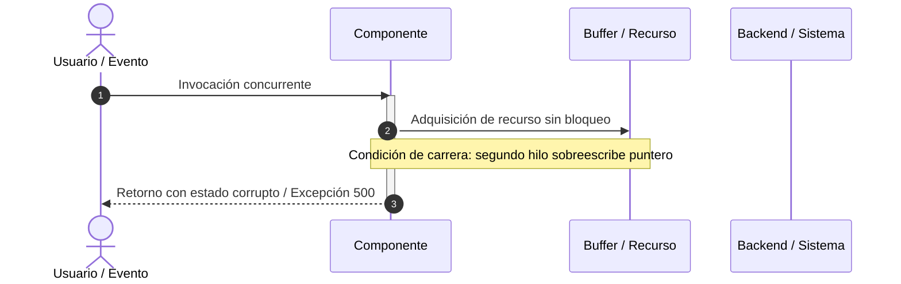

# Plantilla de Informe: Diagnóstico Forense y Causa Raíz (Bug / Post-Mortem)

Usa esta plantilla cuando la necesidad del usuario sea investigar un bug complejo, fuga de memoria, condición de carrera (*race condition*) o comportamiento anómalo intermitente.

```markdown
# 🩺 Diagnóstico Forense y Resolución: `{{ISSUE_TITLE}}`

> **Severidad:** 🔴 Crítica / 🟡 Media / 🟢 Leve
> **Componente Afectado:** `{{AFFECTED_COMPONENT_PATH}}`
> **Causa Raíz en 1 Línea (TL;DR):** {{ONE_LINE_ROOT_CAUSE}}

---

## ⏱️ Secuencia de Reproducción del Fallo



---

## 🔍 Análisis de Causa Raíz (Root Cause Analysis - RCA)

* **Mecanismo del fallo:** {{DETAILED_EXPLANATION_OF_FAILURE}}
* **Por qué pasó desapercibido:** {{WHY_TESTS_MISSED_IT}}
* **Condiciones de activación:** Carga > X peticiones simultáneas, reconexiones de red o valores nulos no tipados.

---

## 📊 Comparativa: Comportamiento Vulnerable vs Blindado

| Aspecto | Implementación con Falla | Implementación Corregida |
| :------ | :----------------------- | :----------------------- |
| **Sincronización** | Acceso directo a variable global | Mutex / Semáforo atómico |
| **Liberación de memoria**| Fuga en listeners huérfanos | `try...finally` con `dispose()` |
| **Manejo de timeouts** | Bloqueo indefinido (Hang) | Interrupción con `AbortSignal` |
| **Comportamiento ante error** | Crash del proceso completo | Fallback controlado con log estructurado |

---

## 🛠️ Parche Definitivo de Corrección

```{{LANG}}
{{FIXED_AND_HARDENED_CODE}}
```

---

## 🧪 Prueba de Regresión (Demostración de que el Bug Está Cerrado)

Esta prueba reproduce exactamente la condición de fallo y confirma que ahora es manejada con éxito:

```{{LANG}}
{{REGRESSION_TEST_CODE}}
```

---

## 🛡️ Medidas Preventivas para el Proyecto
1. Incorporar linter rule para evitar llamadas no sincronizadas sobre recursos compartidos.
2. Añadir prueba de estrés concurrente en el pipeline de integración continua.
```
