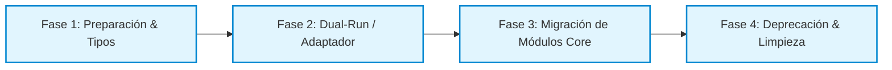

# Plantilla de Informe: Evaluación de Migración y Actualización Tecnológica

Usa esta plantilla cuando la necesidad del usuario sea evaluar o planificar la migración de una biblioteca, framework o versión mayor (ej. de REST a gRPC, de Vue 2 a 3, de Webpack a Vite, o una actualización de SemVer con breaking changes).

```markdown
# 🔄 Evaluación Técnica de Migración: `{{CURRENT_TECH}}` ➔ `{{TARGET_TECH}}`

> **Impacto de la Migración:** 🔴 Alto (Breaking Changes) / 🟡 Moderado / 🟢 Bajo
> **Esfuerzo Estimado:** {{ESTIMATED_EFFORT}}
> **Recomendación Final:** 🟢 Proceder con migración / 🟡 Esperar madurez / 🔴 Permanecer en solución actual

---

## 🗺️ Hoja de Ruta de Migración por Fases



---

## ⚖️ Matriz de Beneficios vs Riesgos de Transición

| Vector de Análisis | Estado Actual (`{{CURRENT_TECH}}`) | Estado Objetivo (`{{TARGET_TECH}}`) | Ganancia Neta / Riesgo |
| :----------------- | :--------------------------------- | :---------------------------------- | :--------------------- |
| **Rendimiento** | {{CURRENT_PERF}} | {{TARGET_PERF}} | 🚀 +{{PERF_IMPROVEMENT}}% |
| **Mantenimiento** | Versión próxima a End-of-Life | Ecosistema activo con soporte a largo plazo | 🛡️ Deuda técnica saldada |
| **Breaking Changes** | API estable | Cambios en {{NUM_BREAKING}} métodos clave | ⚠️ Requiere refactorización |
| **Curva de Aprendizaje**| Conocido por el equipo | Requiere nuevo paradigma | ⏱️ 1-2 semanas de adaptación |

---

## ⚠️ Análisis de Cambios Disruptivos (Breaking Changes) y Mitigaciones

### 1. `{{BREAKING_API_1}}`
* **Comportamiento anterior:** `{{OLD_BEHAVIOR}}`
* **Nuevo comportamiento:** `{{NEW_BEHAVIOR}}`
* **Patrón de compatibilidad / Adaptador:**
```{{LANG}}
// Capa de compatibilidad temporal para evitar romper consumidores existentes
{{ADAPTER_CODE_SNIPPET}}
```

---

## 📦 Plan de Ejecución y Código de Ejemplo

### Paso 1: Actualización de Dependencias
```bash
{{INSTALL_OR_MIGRATE_COMMANDS}}
```

### Paso 2: Implementación con la Nueva Tecnología
```{{LANG}}
{{MODERN_TARGET_CODE}}
```

---

## 🛡️ Estrategia de Rollback (Plan de Contingencia)
En caso de fallo en producción tras el despliegue:
1. Revertir versión de dependencias mediante `git revert` o bloqueo de lockfile.
2. La capa de abstracción/adaptador permite conmutar la bandera de configuración `USE_NEW_ENGINE=false` sin re-compilar.
```
