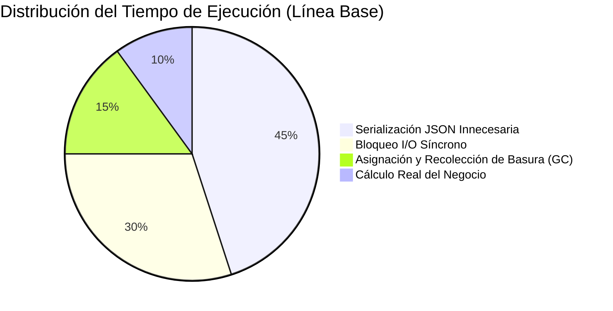

# Plantilla de Informe: Benchmarking de Rendimiento & Perfilado

Usa esta plantilla cuando la necesidad del usuario sea medir, comparar y optimizar el rendimiento de una función, algoritmo o servicio (operaciones/segundo, latencia p50/p95/p99, huella de memoria y uso de CPU).

```markdown
# ⚡ Benchmarking de Rendimiento: `{{BENCHMARK_TARGET}}`

> **Métrica Clave:** Ops/sec & Latencia p95 bajo carga
> **Entorno de Prueba:** {{ENVIRONMENT_DETAILS}}
> **Mejora Lograda:** 🚀 **{{SPEEDUP_FACTOR}}x más rápido** (Reducción de latencia: -{{LATENCY_REDUCTION}}%)

---

## 📈 Comparativa de Rendimiento

| Implementación | Rendimiento (Ops/seg) | Latencia p50 | Latencia p99 | Huella de RAM | Asignaciones / Op |
| :------------- | :-------------------: | :----------: | :----------: | :-----------: | :---------------: |
| **Línea Base (Actual)** | {{BASELINE_OPS}} ops/s | {{BASE_P50}} ms | {{BASE_P99}} ms | {{BASE_RAM}} MB | {{BASE_ALLOCS}} allocs |
| **Optimización Intermedia** | {{OPT1_OPS}} ops/s | {{OPT1_P50}} ms | {{OPT1_P99}} ms | {{OPT1_RAM}} MB | {{OPT1_ALLOCS}} allocs |
| **Versión Optimizada Final** | 🟢 **{{FINAL_OPS}} ops/s** | 🟢 **{{FINAL_P50}} ms** | 🟢 **{{FINAL_P99}} ms** | 🟢 **{{FINAL_RAM}} MB** | 🟢 **0 allocs** |

---

## 🔬 Cuellos de Botella Identificados (Profiling Breakdown)



* **Cuello de botella 1:** {{BOTTLENECK_1_EXPLANATION}}
* **Cuello de botella 2:** {{BOTTLENECK_2_EXPLANATION}}

---

## 🛠️ Código Optimizado de Alto Rendimiento

### Implementación Refinada
```{{LANG}}
{{HIGH_PERFORMANCE_CODE}}
```

* **Técnicas aplicadas:**
  - Eliminación de copias intermedias en memoria (Zero-copy buffers).
  - Pre-asignación de capacidad para evitar redimensionamientos dinámicos.
  - Reemplazo de expresiones regulares en bucles críticos por búsqueda directa.

---

## 🧪 Script de Benchmark Reproducible

Ejecuta este script para replicar exactamente los resultados obtenidos:

```{{LANG}}
{{REPRODUCIBLE_BENCHMARK_SCRIPT}}
```
```
